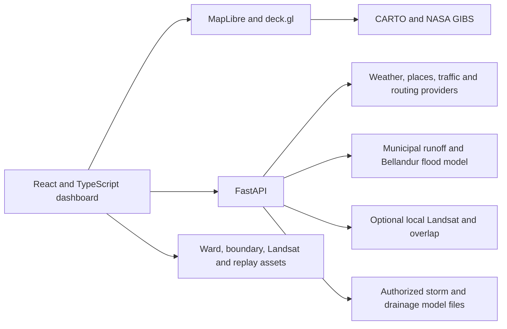

# CityShield

CityShield is an India-wide weather and road-routing map with a research workspace for urban flooding and surface heat in Bengaluru. Search for a place to check a forecast, compare driving routes, or inspect nationwide weather screens. Select Bengaluru or one of its wards to run a rainfall scenario, compare runoff, and inspect the evidence behind the local models.

[Hosted frontend](https://cityshield-fawn.vercel.app) · [Source and provenance](docs/DATA_SOURCES.md) · [Bengaluru evaluation](docs/BENGALURU_EVALUATION.md) · [Contributing](CONTRIBUTING.md)

> CityShield is a research prototype. Use official local advisories for flood, heat, emergency, and travel decisions. Forecast estimates, simulated depths, and route recommendations do not establish that a location or road is safe.

## Contents

- [Features and coverage](#features-and-coverage)
- [Using the dashboard](#using-the-dashboard)
- [Local setup](#local-setup)
- [Configuration](#configuration)
- [Architecture and repository layout](#architecture-and-repository-layout)
- [API reference](#api-reference)
- [Data, methods, and evaluation](#data-methods-and-evaluation)
- [Reproducing data and model workflows](#reproducing-data-and-model-workflows)
- [Testing, deployment, and troubleshooting](#testing-deployment-and-troubleshooting)
- [Project documentation, citation, and license](#project-documentation-citation-and-license)

## Features and coverage

| Feature | Coverage | What it shows |
| --- | --- | --- |
| Place search and driving routes | India, subject to map and routing provider coverage | OpenStreetMap places, car routes, alternate routes when available, optional traffic, and permission-based GPS tracking. Bengaluru also has a bundled English and Kannada index of 369 GBA wards. |
| Point weather and reports | Selected Indian coordinates, with Bengaluru as the default forecast location | Current model estimate, three hourly estimates, a 48-hour report with CSV export, and an optional longer point forecast. The point details can also show modeled air quality where available. |
| **Flood**, **Heat**, and **Combined** | India forecast grid, where the provider supplies values | Forecast rain over 24 hours, forecast air temperature at 2 m, and cells that cross both illustrative thresholds. Map hexagons change size with zoom. The underlying forecast grid stays at 0.25°. |
| **Surface temperature** | India map, where the satellite product has imagery | Daily daytime MODIS land-surface-temperature imagery served through NASA GIBS. Look for gaps from clouds and acquisition timing. |
| **Bengaluru runoff** and mapped road runoff | 2025 Greater Bengaluru Authority (GBA) municipal polygon | Estimated runoff in terrain depressions for a supplied rainfall scenario. Visible mapped roads can be highlighted where they cross a screened 300 m cell. |
| **Bengaluru Landsat** and ward analysis | Bundled data for the 2025 GBA boundary | Modeled land-surface temperature from the April 1, 2026 Landsat acquisition. Ward analysis lists area-weighted runoff and surface temperature where valid data overlap the ward. |
| Bellandur pilot and **Bellandur combined exposure** | Configured pilot network and Landsat study area | Simulated node depths, road classes, facility access risk, pilot routes, and a 30 m flood/heat overlap layer when compatible heat inputs are installed. |
| Storm replay and comparison | Published Bengaluru case study and any authorized, installed event bundles | Published 20–21 October 2020 drain readings and study model peaks. A compatible surveyed drainage run enables paired depth and timing comparisons for an imported event. |
| CX assistant and community tools | Supported browser and selected location | Opt-in spoken alerts and voice commands, weather and traffic reports, a forecast scan of the bundled Indian city catalog, nearby mapped facilities, and local-only unverified reports. |

The India services accept coordinates in a bounding rectangle of 6–38°N and 68–98°E. The application uses boundary geometry and provider coverage where applicable. The local runoff grid and historical Landsat layer are clipped to the GBA municipal outline. Places outside it, including southern suburbs, can still use the broader weather and routing services. A local map view, a provider estimate, and an instrument reading each describe a different quantity or geographic area.

## Using the dashboard

### Search and read the forecast

1. Search for an Indian city, town, or landmark. Use `Ctrl+K` or `Cmd+K` to focus search and the arrow keys to move through suggestions. Select a bundled Bengaluru ward to open **Ward analysis** and outline it on the map.
2. Open **Next 3 hours** in the overview or the map tools menu. The forecast follows the selected place or active navigation location. Values show air temperature, feels-like temperature, rainfall, and humidity when supplied. Times in the dashboard use India Standard Time.
3. Open **Weather** or **Two-day weather report** for the next 48 hourly estimates. Use **Refresh report** to request an update and **Export CSV** to save the hourly readings, valid times in UTC and IST, grid coordinates, and retrieval time.
4. Turn on **Flood**, **Heat**, or **Combined** to look across the map. The combined screen highlights cells with at least 20 mm of forecast rain in 24 hours and at least 35 °C at 2 m. Read each layer's legend for its units and coverage. The report and CX city scan use a separate 24-hour threshold of 64.5 mm for heavy rain and 40 °C for high temperature.

### Run and compare Bengaluru scenarios

1. Select Bengaluru or a GBA ward in search, or select Bengaluru under **Scenarios → Simulation area**.
2. Choose a preset or enter rainfall intensity and duration. **Run local simulation** applies that input to the municipal runoff grid and the Bellandur pilot. Total rainfall in millimetres equals intensity in mm/h multiplied by duration in minutes, divided by 60. The **Flood demo** preset supplies 200 mm in two hours.
3. Inspect **Bengaluru runoff** on the map. Zoom in to see screened sections of mapped roads when **Show local road runoff** is enabled. Use **Data sources → Show simulated depth and road segments** to view the pilot output and select a node for its explanation and prediction spread. The advanced air-temperature offset applies to the India forecast display and its combined screen. A separate Landsat surface-temperature offset applies to the municipal Landsat display and ward analysis. Both offsets are hypothetical display adjustments.
4. Open **Compare scenarios** or **Compare this ward**. Save the current inputs or a preset as a baseline. The city view counts distinct 300 m cells above 20 mm of screened runoff. Ward analysis reports mean runoff and the share of scored ward area above the same threshold. **Export comparison CSV** records the scope, inputs, metrics, and provenance. Baseline inputs are stored in the current browser and recalculated on later visits.
5. Use **Stop simulation** to clear the local scenario and simulated route exposure. **Data sources** shows source availability, source dates, and the status of optional local heat inputs. **Storm replay** opens the published 2020 event independently of any running scenario.

### Compare routes, use GPS, and try CX

1. Open **Routes** or choose **Car routes** in map tools. Use place search, **Pick on map**, or **Use my current location** for the source. Compare routes by ETA and distance. TomTom can supply traffic-aware ETAs and nearby flood incident reports when its key and coverage are available. Valhalla supplies road-network estimates as the no-key routing path.
2. Review traffic and rain exposure for each option. CityShield can recommend a route using available flood reports, comparable modeled runoff exposure, and provider ETA. Scenario exposure and the demo ETA are separate from the provider's route estimate. Expected weather and road conditions can change during a trip.
3. Choose a route and press **Start navigation** to recalculate from a fresh device GPS fix and track progress. The app shows GPS accuracy, speed when supplied, remaining distance, and ETA. Off-route fixes can trigger recalculation. Active CX voice sessions can read upcoming provider instructions when the route and GPS fix support them. Browser geolocation requires permission and a secure context such as HTTPS or localhost. **Start car simulation** runs a route preview without GPS where the flood demo supports it.
4. Open **Assistant** under the map for the CX menu. Use the forecast or traffic reports, turn on spoken alerts, or choose **Start talking** in a browser with speech recognition and synthesis. Say “Hello CX” and try “weather in Mysuru” or “navigate to Lalbagh.” Say **Stop listening** or close CX to end the session. Optional Gemini conversation uses the text of recognized commands and recent turns. Browser speech recognition may process microphone audio online. Route and weather providers receive the coordinates needed for their requests.
5. Under **Data sources**, browse the sourced flood event timeline, look up mapped community or emergency facilities, or save an unverified report in this browser. An OpenStreetMap listing gives a location and category. Confirm opening status, emergency access, and service availability directly. Local reports remain in this browser until cleared.

## Local setup

Use Python **3.11**, Node.js **20**, and npm to match CI. Git is needed to clone. The default backend uses SQLite-compatible configuration and a deterministic synthetic pilot, so a database container, provider key, and Landsat download are optional. The basemap and live provider features require a network connection. A first backend start can take longer while it builds its pilot data and trains the local FloodGNN checkpoint if one is missing.

```bash
git clone https://github.com/bibek200620/cityshield.git
cd cityshield
```

Start the API and frontend in separate terminals. Each code block below starts from the repository root. Copy the examples only when the destination files do not already exist.

### Windows PowerShell

**Terminal 1**

```powershell
Copy-Item .env.example backend/.env
Set-Location backend
py -3.11 -m venv .venv
.\.venv\Scripts\python.exe -m pip install -r requirements.txt
.\.venv\Scripts\python.exe -m uvicorn app.main:app --reload --host 127.0.0.1 --port 8000
```

**Terminal 2**

```powershell
Set-Location frontend
Copy-Item .env.example .env
npm ci
npm run dev -- --host 127.0.0.1
```

### macOS and Linux

**Terminal 1**

```bash
cp .env.example backend/.env
cd backend
python3.11 -m venv .venv
source .venv/bin/activate
python -m pip install -r requirements.txt
python -m uvicorn app.main:app --reload --host 127.0.0.1 --port 8000
```

If XGBoost reports a missing OpenMP library on macOS, install it with `brew install libomp`.

**Terminal 2**

```bash
cd frontend
cp .env.example .env
npm ci
npm run dev -- --host 127.0.0.1
```

Open the [dashboard](http://localhost:5173), [Swagger UI](http://localhost:8000/docs), or [API health response](http://localhost:8000/api/health). The copied backend example allows the `http://localhost:5173` origin. Add `http://127.0.0.1:5173` to `CORS_ORIGINS` if you use that address in the browser.

### Docker Compose

Run `docker compose up --build` from the repository root. Compose starts PostGIS on `5432`, FastAPI on `8000`, and the Vite development server on `5173`. The backend image pretrains a smaller synthetic checkpoint during the build. Compose is configured for development and uses example database credentials. Supply backend keys through environment variables or an explicit Compose override. The wrapper does not mount local storm or heat files automatically.

## Configuration

FastAPI reads environment variables and `backend/.env` when launched from `backend/`. Set frontend variables in `frontend/.env` before starting Vite or building. Keep provider credentials on the server. Vite embeds `VITE_*` settings in the public frontend bundle.

| Setting | Purpose |
| --- | --- |
| `VITE_API_BASE_URL` | Base URL of FastAPI, such as `http://localhost:8000`. Restart Vite after changing it. Rebuild deployed frontend assets when it changes. |
| `CORS_ORIGINS` | Comma-separated browser origins, including scheme and port where applicable. Match the URL actually used to open the frontend. |
| `PILOT_MODE`, `REAL_WARD_BBOX` | `synthetic` is the default. `real` uses network-derived terrain and roads inside the supplied bounding box. Bounds use `min_lon,min_lat,max_lon,max_lat`. |
| `DB_MODE`, `DATABASE_URL`, `POSTGIS_URL` | SQLite or PostGIS configuration. Compose supplies its own internal PostGIS URL. |
| `SYNTHETIC_SEED`, `GRID_SIZE_CELLS`, `GRID_RESOLUTION_M`, `ANCHOR_LAT`, `ANCHOR_LNG` | Synthetic generation repeatability, grid size and spacing, and map anchoring. The application defaults to 100 cells per side at 20 m. The Docker checkpoint uses build arguments defaulting to 25 cells and 80 m. |
| `MODEL_CHECKPOINT_PATH`, `MC_DROPOUT_SAMPLES` | Flood surrogate checkpoint location and stochastic inference sample count. The cache inserts the pilot mode as a directory in the checkpoint path. |
| `DRAIN_DIAMETER_*_MM`, `MANNINGS_N_CONCRETE`, `IA_COEFFICIENT`, `DEPTH_THRESHOLD_*_M` | Drainage, runoff, and road-class model assumptions. The example provides the default values. |
| `HEAT_SCENE_DIR`, `HEAT_MODEL_PATH`, `HEAT_AOI_BBOX` | Local Landsat inputs, trained heat model, and study bounds for the Bellandur heat API and overlap. |
| `STORM_EVENT_DIR` | Optional directory of authorized observation manifests and the `model_runs/` subdirectory. The default is `backend/data/storm_events/` when running from `backend/`. |
| `PLACE_SEARCH_URL` | Nominatim-compatible search endpoint. The default is the OpenStreetMap public service. |
| `TOMTOM_API_KEY` | Optional traffic-aware routing, incidents, and traffic flow. |
| `METEOBLUE_API_KEY` | Optional Meteoblue point-forecast provider, read from the backend environment. The keyless point path uses the standard 48-hour forecast when available. |
| `GEMINI_API_KEY`, `GEMINI_MODEL`, `CX_CONVERSATION_ENABLED` | Optional Gemini phrasing and voice conversation. The default model is `gemini-2.5-flash-lite`. To keep local voice commands and disable conversation, set `CX_CONVERSATION_ENABLED=false`. |

See [.env.example](.env.example), [frontend/.env.example](frontend/.env.example), and [backend settings](backend/app/core/config.py) for defaults and operator-specific options.

## Architecture and repository layout



| Path | Responsibility |
| --- | --- |
| [`frontend/src/App.tsx`](frontend/src/App.tsx), [`frontend/src/components/`](frontend/src/components/) | Dashboard, map layers, scenario and evidence panels, route planner, and CX interface. |
| [`frontend/src/api/`](frontend/src/api/), [`frontend/src/map/`](frontend/src/map/), [`frontend/src/store/`](frontend/src/store/) | API types and fallbacks, weather and route handling, spatial summaries, and Zustand scenario state. |
| [`frontend/public/data/`](frontend/public/data/), [`frontend/src/data/`](frontend/src/data/) | Bundled map boundaries, city and ward catalogs, display geometry, historical heat, and replay data. |
| [`backend/app/main.py`](backend/app/main.py), [`backend/app/api/`](backend/app/api/) | FastAPI startup, routes, request schemas, and live WebSocket. |
| [`backend/app/gis/`](backend/app/gis/), [`backend/app/hydrology/`](backend/app/hydrology/), [`backend/app/ml/`](backend/app/ml/) | Pilot terrain, drainage and networks, municipal runoff, surrogate training and inference, explanation, and storm import and evaluation. |
| [`backend/app/heat/`](backend/app/heat/), [`backend/app/geo/`](backend/app/geo/) | Landsat preprocessing and XGBoost modeling, separate air-temperature research baselines, and common-grid alignment. |
| [`backend/app/routing/`](backend/app/routing/), [`backend/app/scenarios/`](backend/app/scenarios/) | Pilot routing, provider integrations, route conditions, and scenario cache. |
| [`scripts/`](scripts/), [`docs/`](docs/), [`third_party/`](third_party/) | Rebuild and import utilities, data/evaluation references, model cards, and upstream notices. |
| [`backend/tests/`](backend/tests/), [`frontend/e2e/`](frontend/e2e/), [`.github/workflows/ci.yml`](.github/workflows/ci.yml) | Backend tests, browser regressions, and continuous integration. |

## API reference

FastAPI publishes Swagger UI at `/docs` and its machine-readable schema at `/openapi.json`. Coordinates are WGS84. JSON request fields use `lat` and `lng` where the request schema specifies them. Weather query strings use `latitude` and `longitude`. Use the generated schema for bounds, required fields, and response details.

| Method and path | Purpose |
| --- | --- |
| `GET /api/health` | API readiness, current pilot mode, and whether startup loaded the model from a checkpoint. |
| `GET /api/scenarios`, `GET /api/scenarios/{scenario_id}`, `POST /api/simulate` | Discover presets, fetch pilot scenario output, and run a custom intensity/duration scenario. |
| `GET /api/flood/city?rainfall_mm=90` | Compute municipal runoff screening for a total rainfall input in millimetres. |
| `GET /api/explain/{node_id}`, `GET /api/critical-infrastructure`, `POST /api/route` | Inspect pilot explanations, facilities, and scenario-specific routing on the pilot road graph. |
| `GET /api/heat`, `GET /api/exposure/{scenario_id}` | Retrieve local Landsat model and pixel data or aligned pilot flood/heat cells when artifacts are compatible. |
| `GET /api/weather/nowcast`, `GET /api/weather/report` | Get current and three-hour estimates, or a 48-hour report. Coordinates default to Bengaluru. |
| `POST /api/weather/grid`, `GET /api/weather/point-forecast`, `GET /api/weather/air-quality` | Batch forecast-grid queries, selected-point forecast, and separate selected-point modeled AQI. |
| `GET /api/places/search`, `GET /api/places/nearby` | Find Indian places by text or query mapped nearby community facilities by coordinates and radius. |
| `POST /api/drive/routes`, `POST /api/drive/traffic-flow`, `POST /api/drive/scenario` | Compare car routes, sample current traffic, or screen route geometry against a local rainfall scenario. |
| `GET /api/flood/events`, `GET /api/backtest`, `GET /api/backtest/{event_id}` | Read the evidence catalog, check observed-event readiness, or request a paired drainage-model comparison. |
| `GET /api/assistant/outlook`, `GET /api/assistant/phrasing`, `POST /api/assistant/route-context`, `POST /api/assistant/conversation` | Assistant weather screening, alert phrasing styles, route context, and optional conversation. |
| `WS /ws/live?scenario_id={scenario_id}` | Stream a cached pilot scenario’s rainfall, node depths and road classes in time order. |

```bash
curl 'http://localhost:8000/api/health'
curl 'http://localhost:8000/api/weather/nowcast?latitude=19.0760&longitude=72.8777'
curl 'http://localhost:8000/api/flood/city?rainfall_mm=90'
```

Use `curl.exe` or `Invoke-RestMethod` on Windows. Some model and provider endpoints return a successful HTTP response with a JSON `status` of `unavailable` or `partial`. Inspect the body before using the values. The backtest catalog returns its displayable events and their readiness, or an empty list. An event-specific lookup returns HTTP 501 when the match is unavailable and HTTP 422 when the supplied run is incompatible.

## Data, methods, and evaluation

| Workflow | Inputs and method | How to interpret the output |
| --- | --- | --- |
| India weather grid and point forecasts | NOAA GFS 0.25° for the national grid. Open-Meteo for the standard point forecasts, with optional Meteoblue point forecasts and a browser Open-Meteo fallback when the API or provider is unavailable. | Rain totals and 2 m temperatures are weather-model estimates at provider resolution. Zoomed hexagons repeat or summarize coarse values. Missing or stale estimates are surfaced where applicable. |
| Municipal runoff | Copernicus GLO-30 elevation, ESA WorldCover, Priority-Flood depression screening, and SCS Curve Number runoff. The output is averaged across land samples in each clipped 300 m cell. | Units are millimetres of estimated runoff from a hypothetical uniform storm. No explicit storm sewer or street hydraulic model sits behind these values. The >20 mm threshold describes the modeled variable only. |
| Bellandur flood surrogate | Rainfall intensity and duration feed the SCS Curve Number calculation, a simplified graph-based physics baseline, and a FloodGNN surrogate with Monte Carlo dropout. | The training targets come from the physics baseline. The default synthetic terrain, roads, drains, and facilities are generated for the demo. Real pilot mode adds mapped terrain and roads with inferred drainage and model assumptions. Depth classes have default cut points of 0.15 m and 0.30 m. Dropout spread measures model variation under those assumptions. |
| Municipal Landsat | Multi-acquisition Landsat Collection 2 Level-2 training and later held-out acquisitions. The checked-in 300 m map aggregates the April 1, 2026 modeled scene. | The city study reports 4.03 °C pooled RMSE across four date-held-out acquisitions, 3.33 °C for the displayed acquisition, and 4.13 °C on its buffered spatial holdout. The comparison target is satellite land-surface temperature from the corresponding acquisition. |
| Bellandur Landsat and local overlap | One aligned Landsat scene, XGBoost, and a spatial-block holdout. Flood node predictions and heat pixels are aligned on a 30 m EPSG:32643 grid. | **Both elevated** requires simulated flood depth of at least 0.15 m and predicted surface temperature in the scene's top decile. This spatial overlap expresses a threshold condition. |
| Historical floods and validation | Published event inventory and 2020 drain observations, plus an importer for licensed rainfall and water-level series and separately exported surveyed-network depths. | Published sensor summaries and published model peaks serve as evidence of the historical event. A CityShield comparison requires exact storm, rainfall, network, datum, and timestamp alignment. The repository ships without a ready paired bundle. The pilot FloodGNN has no observed-event validation score. |

CityShield keeps forecast air temperature, satellite land-surface temperature, and station observations distinct. The ERA5-Land and NOAA station baselines are reproducible research workflows in `backend/app/heat/` and remain separate from the live forecast service. See the [data catalog](docs/DATA_SOURCES.md), [Bengaluru evaluation](docs/BENGALURU_EVALUATION.md), [model cards](docs/MODEL_CARDS.md), and [common-grid method](docs/GEO_ALIGNMENT.md).

## Reproducing data and model workflows

### Bellandur Landsat model and overlap

1. Obtain a Landsat 8/9 Collection 2 Level-2 scene with compatible reuse terms. Put its `SR_B2` through `SR_B7`, `ST_B10`, `ST_EMIS`, and `QA_PIXEL` GeoTIFFs in `backend/data/heat/landsat/`. All files must share one scene prefix. Set `HEAT_AOI_BBOX` to an area covered by the scene.
2. From `backend/` with the virtual environment active, run `python -m app.heat.train`. Training writes the XGBoost JSON model and metadata in `backend/data/heat/model/` by default. The metadata records input identity, feature order, holdout definition, seed, parameters, and metrics.
3. Query `/api/heat` and run a local rainfall scenario. `/api/exposure/{scenario_id}` reports the aligned results. If either workflow is unavailable, check the API message and compare the scene prefix, AOI, and expected model files. See the [single-scene workflow](docs/HEAT_WORKFLOW.md).

### Municipal and historical assets

| Task | Command or workflow |
| --- | --- |
| Rebuild the municipal runoff input | From `backend/`, run `python -m app.hydrology.build_city_flood`. It writes `app/hydrology/bengaluru_flood_grid.json.gz`. See the [municipal method and source terms](docs/BENGALURU_EVALUATION.md#citywide-flood-screening). |
| Reproduce the city heat study | From `backend/`, run `python -m app.heat.city_study`, then `python -m app.heat.city_study --export-map` to write `frontend/public/data/bengaluru-heat.json`. The study has separate scene caches, model, and evaluation files. See the [multi-acquisition workflow](docs/BENGALURU_EVALUATION.md#city-land-surface-temperature). |
| Rebuild display meshes and ward overlaps | From the repository root with the backend environment active, run `python scripts/build_map_hexes.py` or `python scripts/build_ward_evidence.py /path/to/wards.geojson`. See the [ward input and checksum](docs/BENGALURU_EVALUATION.md#ward-analysis-and-scenario-comparison). |
| Rebuild the published replay | From the root, run `python scripts/build_storm_replay.py`. It reads the checked-in sensor summary plus transcribed published comparison values. See [published replay provenance](docs/FLOOD_EVENT_DATA.md#storm-replay-in-the-browser). |
| Inspect and install a storm | From the root, run `python scripts/import_storm_event.py /path/to/observations.json` to inspect. Repeat with `--install` to write a validated local bundle. Add the matching model export under `model_runs/` and use **Storm replay → Find imported storms**. See the [bundle and model-run contract](docs/STORM_BUNDLE.md). |
| Reproduce air-temperature baselines | See the [ERA5-Land reanalysis workflow](docs/HEATWAVE_REANALYSIS.md) and the [NOAA observed station workflow](docs/HEATWAVE_STATION_BASELINE.md) for the commands, splits, and evaluation targets. |

Keep raw data and generated checkpoints in their configured local or authorized storage locations. Preserve permissions, source identifiers, units, CRS, retrieval dates, and evaluation splits when preparing any new artifact.

## Testing, deployment, and troubleshooting

### Run the checks

With the backend environment active, run from `backend/`.

```bash
python -m pytest --cov=app --cov-report=term-missing
```

From `frontend/`, install dependencies before running these commands.

```bash
npm run lint
npm run build
npx playwright install chromium
npm run test:e2e
```

Playwright starts Vite on port `5173` and mocks many external responses. The suites cover map layers, forecast and route workflows, CX, ward evidence, local reporting, and historical replay. GitHub Actions runs Python 3.11 and Node.js 20 jobs on pushes and pull requests. [CI configuration](.github/workflows/ci.yml)

### Deploy the services

Build `frontend/` with Vite and publish `dist/`. The repository's hosted frontend is configured on Vercel, with the FastAPI service hosted separately on Render. Set `VITE_API_BASE_URL` to the public HTTPS API origin at build time. Set the backend `CORS_ORIGINS` to the actual frontend origin. On the backend, use `backend/Dockerfile` or the Uvicorn entry point. Match the synthetic grid settings to the checkpoint build profile if deploying the prebuilt checkpoint. Mount or provision authorized storm and Landsat artifacts on the backend if the corresponding features are needed. Check `/api/health`, the point forecast, and `/api/backtest` after deploying, then confirm the dashboard can reach the API from its hosted origin.

### Diagnose common issues

| Symptom | Check |
| --- | --- |
| API cannot connect or the browser reports CORS errors | Check `/api/health`, `VITE_API_BASE_URL`, and the exact browser origin in `CORS_ORIGINS`. Restart the affected dev server after changing env files. |
| Startup takes a long time | A missing mode-specific checkpoint can trigger training. The Docker image pretrains its synthetic checkpoint. Check logs for model loading and for network access in real pilot mode. |
| Basemap is blank or a forecast layer has gaps | Check WebGL and access to the CARTO style and map tiles. Weather grid requests can be partial, and satellite imagery can have cloud gaps. The legend and **Data sources** show availability. |
| **Run local simulation** is disabled | Select Bengaluru or a GBA ward, or wait for the current run to finish. The national forecast layers work independently of the scenario. |
| `/api/heat` or **Bellandur combined exposure** is unavailable | Check that the local Landsat bands, AOI, model JSON, and its metadata are compatible. Run a local rainfall scenario for the overlap. |
| GPS or voice is unavailable | Check browser permissions, use HTTPS or localhost, and verify that the browser exposes the required speech or location APIs. Manual search, map picking, and the written panels are available. |
| **Storm replay** opens but no comparison is ready | Check `STORM_EVENT_DIR` and `/api/backtest`. Imported results require permission to display both files, matching network and rainfall identities, and paired time series. |
| `npm run build` reports large chunks | Vite can emit a size advisory for the shared mapping and visualization libraries. A successful build still writes `frontend/dist/`. |

## Project documentation, citation, and license

- **Methods and provenance** · [Architecture](docs/ARCHITECTURE.md) · [Data sources](docs/DATA_SOURCES.md) · [Bengaluru coverage and evaluation](docs/BENGALURU_EVALUATION.md) · [Model cards](docs/MODEL_CARDS.md)
- **Flood research** · [Event evidence](docs/FLOOD_EVENT_DATA.md) · [Storm bundle](docs/STORM_BUNDLE.md) · [Data request](docs/STORM_DATA_REQUEST.md) · [Observed-event benchmark notes](docs/ISSUE5_RESEARCH_BENCHMARK.md)
- **Heat research** · [Landsat preparation](docs/HEAT_WORKFLOW.md) · [Common-grid alignment](docs/GEO_ALIGNMENT.md) · [Reanalysis baseline](docs/HEATWAVE_REANALYSIS.md) · [Station baseline](docs/HEATWAVE_STATION_BASELINE.md)
- **Project maintenance** · [Contribution guide](CONTRIBUTING.md) · [Changelog](CHANGELOG.md) · [Security policy](SECURITY.md) · [Third-party notices](docs/THIRD_PARTY_NOTICES.md)

Cite **CityShield: Urban Climate and Geospatial Risk Intelligence** using [CITATION.cff](CITATION.cff) and cite the upstream datasets and papers used in your analysis. The application builds on [Nimbus](https://github.com/SagnickInTheShell/Nimbus). Landsat feature preparation adapts work from [urban-heat-island-bengaluru](https://github.com/NishanthAlampally/urban-heat-island-bengaluru), and VIALERT informed the route comparison workflow.

The application is distributed under the [MIT license](LICENSE). The UHI reference project's [MIT notice](third_party/urban-heat-island-bengaluru/LICENSE) is preserved separately. Datasets, map tiles, fonts, and provider services retain their applicable licenses and attribution requirements. [Third-party notices](docs/THIRD_PARTY_NOTICES.md)
